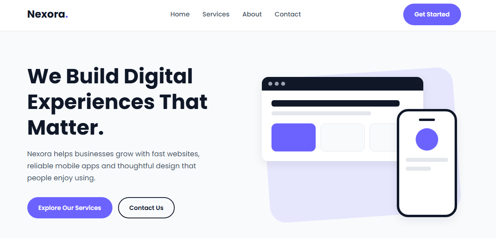
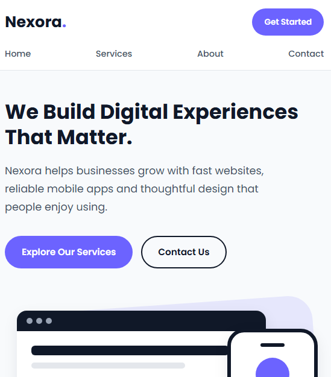

# Nexora - Digital Solutions (Landing Page)

**Oasis Infobyte Internship (OIBSIP)** | Track: Web Development and Designing | Task 1 (Level 1)

A responsive static landing page for a fictional technology brand called **Nexora**, which offers web development, mobile app development and UI/UX design. All brand names and testimonials are sample content.

## Tech stack
- HTML5
- CSS3 (Flexbox and Grid)
- Google Fonts (Poppins)
- No JavaScript, frameworks or libraries

## Features
- Sticky navigation bar with Home, Services, About and Contact links and a "Get Started" button
- Hero section with headline, subheadline, two call-to-action buttons and a CSS-made graphic
- Services section with three cards
- About section with three highlights
- Testimonials section with three sample reviews
- Call-to-action section
- Footer with placeholder email, LinkedIn, Instagram and GitHub links
- Consistent colour palette: `#101828`, `#6C63FF`, `#F8FAFC`, `#FFFFFF`, `#475467`
- Responsive layout for desktop, tablet and mobile

## How to run
1. Download or clone this repository.
2. Open the `WebDev-L1-LandingPage` folder in VS Code.
3. Right-click `index.html` and choose **Open with Live Server**, or simply double-click `index.html` to open it in a browser.

## Screenshots
**Desktop**

**Mobile**

## Author
Zainab Muneer - [GitHub](https://github.com/zainabmuneer566)